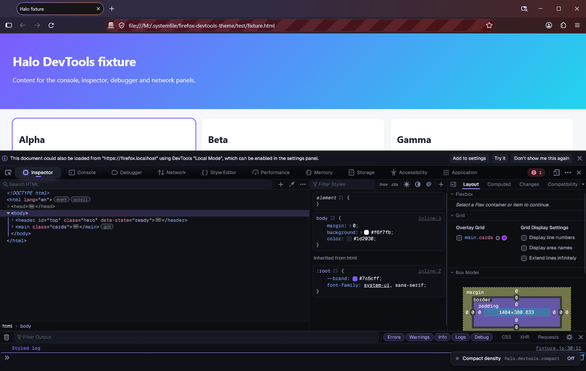
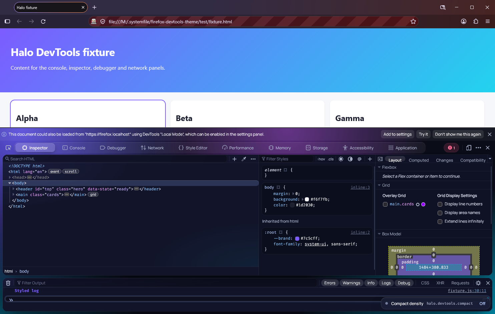
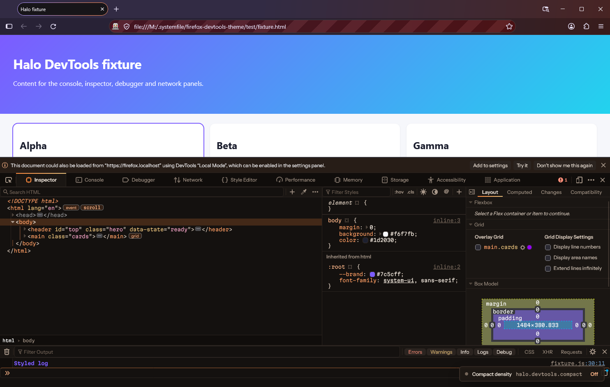
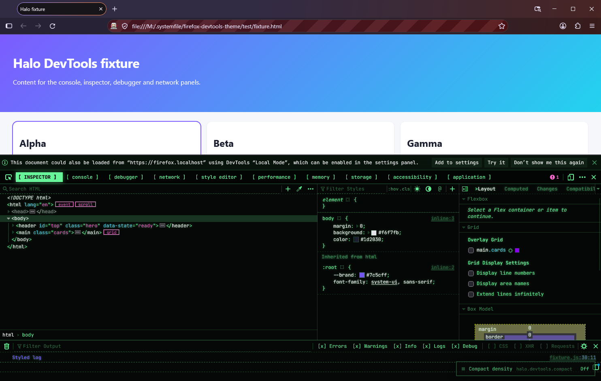
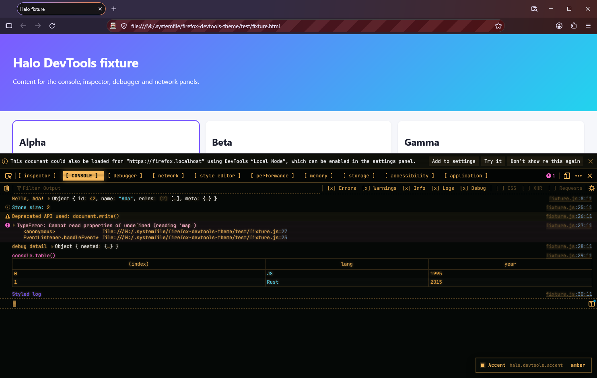
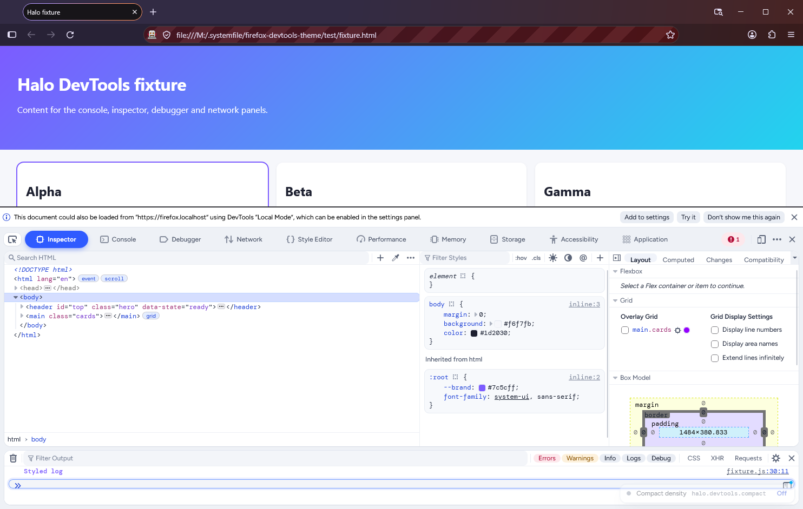
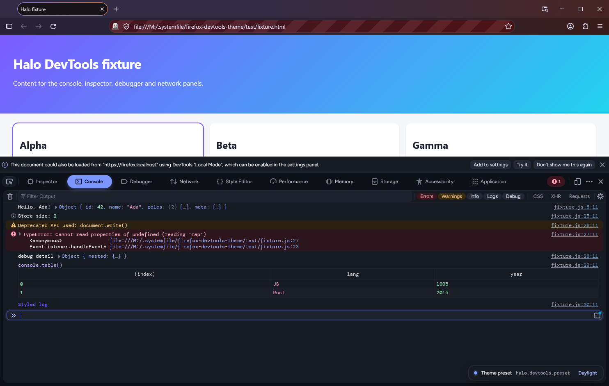

# Halo DevTools

A full redesign of the Firefox DevTools with **five switchable looks**. Pick one with a single `about:config` pref. Every other part of the theme is also a pref, and every change applies live, with no restart. A small privileged JS module adds UI mods on top.

Tested on Firefox 160 (Windows) with the real browser. See [Testing](#testing).

## Presets

Set `halo.devtools.preset` to one of these names. <kbd>Ctrl</kbd>+<kbd>Alt</kbd>+<kbd>Shift</kbd>+<kbd>P</kbd> cycles through them.

| | |
|---|---|
| **`halo`** (default): graphite with a violet accent, Geist and Geist Mono. Pill tabs with a sliding indicator, coloured stripes on warnings and errors, CSS rules as cards. **Follows DevTools light/dark.** |  |
| **`glass`**: floating rounded panels over an aurora gradient, a segmented tab control, frosted fields, console rows as rounded chips. Manrope and Fira Code. Dark only. |  |
| **`ember`**: a warm, dense IDE look. Flat editor tabs with a copper-to-gold top line, an icon gutter in the console, indent guides in the HTML tree, breadcrumbs as a status bar, CSS rules as a flat list. Instrument Sans and Martian Mono. Dark only. |  |
| **`terminal`**: phosphor text on black. `[ bracket ]` tabs with the selected one inverted, `[x]` filter toggles, dashed lines, square corners, glowing text and scanlines. JetBrains Mono everywhere. Dark only. Changing the accent re-tints all the text (amber shown below). |   |
| **`daylight`**: solid panels floating on a cool canvas with soft shadows, cobalt pill tabs, tinted chips for errors and warnings. Figtree and DM Mono. **Follows DevTools light/dark** (light shown first, then dark). |   |

"Dark only" presets force dark colours even when DevTools is set to light, because their look depends on a dark background. An unknown preset name falls back to plain Halo.

## Install

### 1. CSS (required)

```powershell
.\install.ps1 -ProfilePath "$env:APPDATA\Mozilla\Firefox\Profiles\<your-profile>"
```

Close Firefox before running it, so the default prefs can be seeded into `prefs.js`. The script:

- copies `chrome/halo/` into `<profile>/chrome/halo/`,
- prepends `@import url("halo/halo.css") (-moz-pref("halo.devtools.enabled"));` to `<profile>/chrome/userContent.css`,
- enables `toolkit.legacyUserProfileCustomizations.stylesheets`,
- seeds every `halo.devtools.*` pref once, without overwriting values you already have.

The presets work CSS-only. They are chosen with `-moz-pref("halo.devtools.preset", "<name>")`, which Firefox 160 supports for string prefs. Every file is wrapped in `@-moz-document url-prefix("chrome://devtools/")…`, so nothing leaks into web pages.

### 2. JS mods (optional)

The JS module needs an autoconfig loader. Use one of these:

- **No loader yet:** copy `loader/config.js` next to `firefox.exe` and `loader/defaults/pref/config-prefs.js` into `<install>/defaults/pref/`. This needs admin rights.
- **Already have a `config.js`** (fx-autoconfig, Sine, a custom one): append the `try { … }` block from [`loader/config.js`](loader/config.js) to your file.
- **fx-autoconfig:** alternatively, copy `chrome/halo/js/halo.sys.mjs` into `chrome/JS/`.

With the module loaded, every `halo.devtools.*` pref is registered as a default. They show up in about:config even without seeding, and "Reset" restores them.

## about:config switches

All of these apply live.

### Look

| Pref | Default | What it does |
|---|---|---|
| `halo.devtools.enabled` | `true` | Master switch for everything |
| `halo.devtools.preset` | `"halo"` | `halo` · `glass` · `ember` · `terminal` · `daylight` |
| `halo.devtools.accent` | `""` | Empty uses the preset's own accent. Also accepts `violet` `blue` `cyan` `green` `amber` `rose` `mono` or any CSS colour (needs JS) |
| `halo.devtools.compact` | `false` | Denser layout. Every preset has a compact layout that is tested |
| `halo.devtools.terminal.scanlines` | `true` | Terminal preset: the scanline and vignette overlay |

### Modules (bool, all default `true`)

These apply to every preset. Turning one off returns that area to stock Firefox styling.

| Pref | What it does |
|---|---|
| `halo.devtools.palette` | Recolours Firefox's own colour variables, so even panels the theme doesn't style directly follow the preset |
| `halo.devtools.font` / `halo.devtools.mono-font` | The preset's interface font / code font |
| `halo.devtools.tabs` | Toolbox and sidebar tab styling |
| `halo.devtools.toolbars` | Inputs, buttons, splitters, popups, notification bars |
| `halo.devtools.console` / `inspector` / `debugger` / `netmonitor` | Per-panel styling |
| `halo.devtools.scrollbars` | Thin scrollbars |
| `halo.devtools.motion` | Transitions, panel fade-in, popup scale-in. Respects reduced motion |
| `halo.devtools.glow` | Accent glow, and the text glow in Terminal |

### JS mods (need the loader)

| Pref | Type | Default | What it does |
|---|---|---|---|
| `halo.devtools.js.enabled` | bool | `true` | Master switch for all JS mods. The CSS keeps working without them |
| `halo.devtools.ui-font-size` / `code-font-size` | int | `12` | Text sizes in px (8–28) |
| `halo.devtools.ui-font-family` / `mono-font-family` | string | `""` | Override the preset's fonts, e.g. `Inter` or `"JetBrains Mono"` |
| `halo.devtools.js.tab-indicator` | bool | `true` | The selected-tab shape slides between tabs. Each preset restyles it: a pill, a frosted segment, an editor tab or a phosphor block |
| `halo.devtools.js.ripple` | bool | `true` | Accent ripple on clicks |
| `halo.devtools.js.tab-scrollbar` | bool | `true` | 3px draggable scrollbar on sidebar tab strips (Layout, Computed…); mouse wheel scrolls them sideways |
| `halo.devtools.js.console-copy` | bool | `true` | Hover a console message to get a **Copy** button |
| `halo.devtools.js.toasts` | bool | `true` | A small toast confirms each `halo.devtools.*` change |
| `halo.devtools.js.hotkeys` | bool | `true` | The hotkeys listed below |

**Hotkeys** (with DevTools focused): <kbd>Ctrl</kbd>+<kbd>Alt</kbd>+<kbd>Shift</kbd> and then

- <kbd>P</kbd> cycles the preset,
- <kbd>A</kbd> cycles the accent,
- <kbd>D</kbd> toggles compact,
- <kbd>M</kbd> toggles motion,
- <kbd>H</kbd> toggles the whole theme (it still works while the theme is off).

## How it's built

```
chrome/
  userContent.css              entry point: one @import gated by halo.devtools.enabled
  halo/
    halo.css                   index: tokens → palette → structural modules → JS-UI styles → preset → density
    modules/*.css              structural modules (each gated by its own pref)
    presets/<name>.css         one per look: token overrides + signature details + @font-face
    presets/shared/floating.css  floating-pane layout shared by glass and daylight
    js/halo.sys.mjs            JS mods: pref defaults, devtools document watcher, features
    fonts/<preset>/            bundled variable woff2 fonts + their OFL licences
loader/                        standalone autoconfig loader
install.ps1                    profile installer
test/                          real-browser harness + fixture page
```

- **Every preset uses the same structural modules.** Shared CSS only reads `--halo-*` tokens. A preset overrides those tokens and adds its own signature details. That's why turning a module off, compact density and the JS mods all work under every preset.
- **Dark-only presets** set `color-scheme: dark !important`. Firefox's own `light-dark()` colours then agree with the preset even when DevTools is in light mode.
- **Floating panes** (Glass, Daylight): each DevTools panel is a separate iframe. The toolbox therefore paints the canvas, and each panel frame is inset by 8px gutters and clipped to rounded corners. A real backdrop blur across iframes isn't possible, so Glass's "frost" is drawn with white-alpha layers instead.
- **JS mods** live in fixed-position overlays outside React-managed trees. Each one removes itself cleanly when its pref is turned off.

## Testing

```powershell
python -I test/harness.py --geckodriver C:\path\to\geckodriver.exe            # all presets + shared behaviour
python -I test/harness.py --preset glass --skip-shared --geckodriver ...      # one preset
```

The harness builds a throwaway profile from this repo. It starts the real Firefox through geckodriver with chrome-context access (`MOZ_REMOTE_ALLOW_SYSTEM_ACCESS=1`) and runs two kinds of checks against the live DevTools DOM.

**For each preset:**
- opens Console, Inspector, Debugger, Network and Style Editor under both DevTools themes, and screenshots each into `test/screenshots/<preset>/`,
- confirms the preset's stylesheet is active,
- confirms its fonts are applied and the font files actually render,
- confirms dark-only presets force dark under DevTools' light theme,
- runs the preset's signature checks (Glass's 8px gutters and 14px panes, Ember's flat rule list and indent guides, Terminal's bracket tabs and scanline switch, Daylight's light and dark canvases, …),
- checks that an accent override applies, and that clearing it falls back to the preset's own accent,
- checks that compact density still fits the tab strip,
- checks the Inspector with the split console docked underneath.

**Shared behaviour:**
- live preset switching, and fallback for an unknown preset,
- the sliding tab indicator,
- the master and per-module switches,
- live font size changes and toasts,
- the console Copy button, including a real clipboard read (this overwrites your clipboard),
- ripple and hotkeys,
- a CSS-only run with `js.enabled = false`,
- no runtime errors.

Current result: **133 checks, 0 failures.**

## Credits

Fonts are bundled under the SIL Open Font License 1.1. The licence files are in `chrome/halo/fonts/<preset>/`:

- Geist and Geist Mono (Vercel)
- Manrope
- Fira Code
- Instrument Sans
- Martian Mono (Evil Martians)
- JetBrains Mono
- Figtree
- DM Mono
