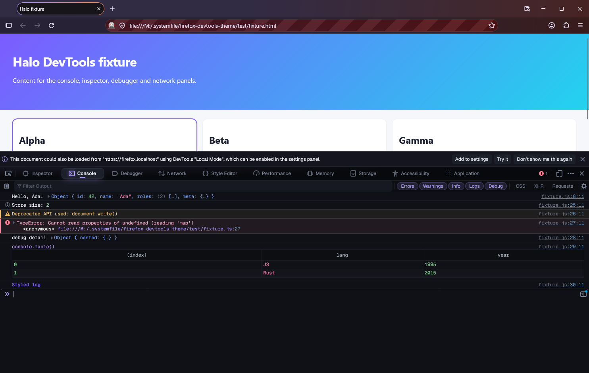
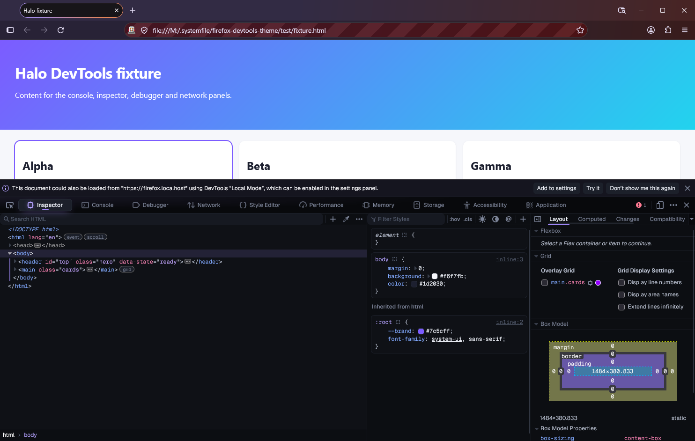
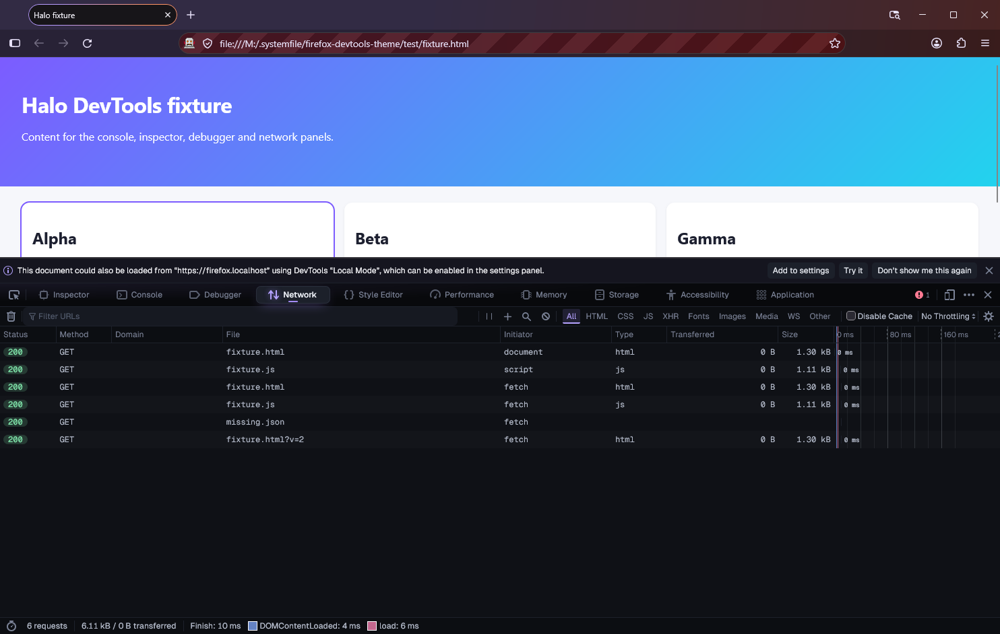
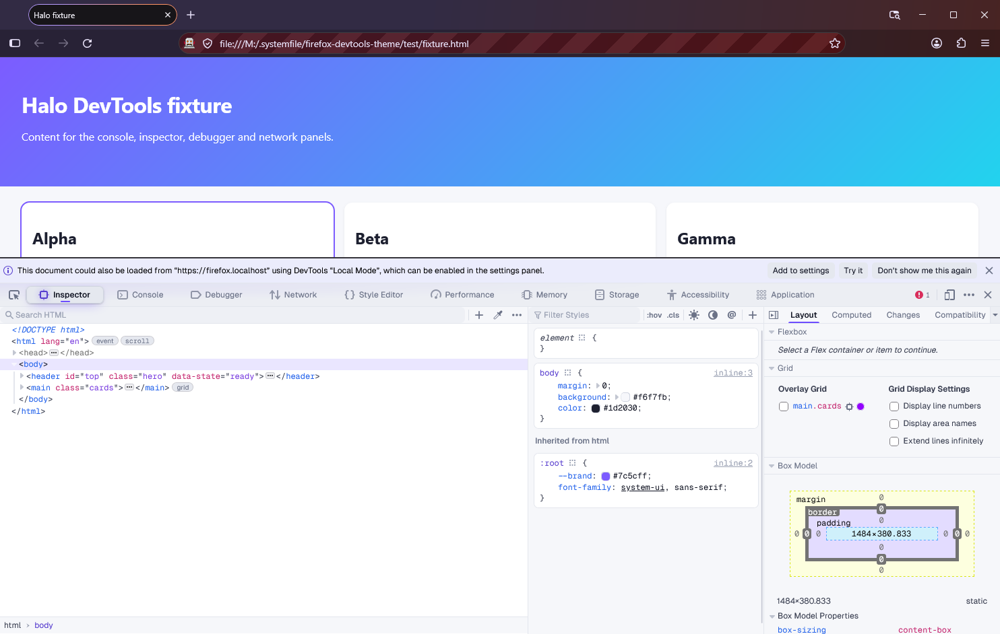

# Halo DevTools

A full redesign of the Firefox DevTools: a graphite palette with one accent colour, the **Geist** / **Geist Mono** typefaces, pill tabs with a sliding indicator, calmer toolbars, card-style CSS rules, status-code pills and short eased motion. A small privileged JS module adds a few UI mods on top. **Every part is a switch in `about:config`** and applies live, with no restart.

Tested on Firefox 160 (Windows) in dark and light DevTools themes. See [Testing](#testing).

| Dark · Console | Dark · Inspector |
|---|---|
|  |  |
| **Dark · Network** | **Light · Inspector** |
|  |  |

## Install

### 1. CSS (required)

```powershell
.\install.ps1 -ProfilePath "$env:APPDATA\Mozilla\Firefox\Profiles\<your-profile>"
```

Close Firefox before running it, so the default prefs can be seeded into `prefs.js`. The script:

- copies `chrome/halo/` into `<profile>/chrome/halo/`,
- prepends `@import url("halo/halo.css") (-moz-pref("halo.devtools.enabled"));` to `<profile>/chrome/userContent.css`,
- enables `toolkit.legacyUserProfileCustomizations.stylesheets`,
- seeds every `halo.devtools.*` pref once, without overwriting values you already have.

To install by hand, do the same steps and set the prefs from [`user.js`](user.js) once in about:config.

Every module file is wrapped in `@-moz-document url-prefix("chrome://devtools/")…`, so nothing leaks into web pages.

### 2. JS mods (optional)

The JS module needs an autoconfig loader, which runs privileged code at startup. Use one of these:

- **No loader yet:** copy `loader/config.js` next to `firefox.exe` and `loader/defaults/pref/config-prefs.js` into `<install>/defaults/pref/`. This needs admin rights.
- **Already have a `config.js`** (fx-autoconfig, Sine, a custom one): don't replace it. Append the `try { … }` block from [`loader/config.js`](loader/config.js) to your file.
- **fx-autoconfig:** alternatively, copy `chrome/halo/js/halo.sys.mjs` into `chrome/JS/`. It is self-contained and has a UserScript header.

With the module loaded, all `halo.devtools.*` prefs are registered as defaults. They show up in about:config even without seeding, and "Reset" restores them.

## about:config switches

All prefs apply live to open toolboxes.

### CSS modules (bool)

| Pref | Default | What it does |
|---|---|---|
| `halo.devtools.enabled` | `true` | Master switch for everything |
| `halo.devtools.palette` | `true` | Graphite palette (remaps Firefox's `--theme-*` vars, so unstyled panels follow) |
| `halo.devtools.font` | `true` | Geist for the UI |
| `halo.devtools.mono-font` | `true` | Geist Mono for code, console, markup and rules |
| `halo.devtools.tabs` | `true` | Pill toolbox tabs, accent underline, restyled sidebar tabs |
| `halo.devtools.toolbars` | `true` | Rounded inputs and buttons, hairline splitters, popups, notification bars |
| `halo.devtools.console` | `true` | Severity rail on warnings and errors, pill filter chips, focused input line |
| `halo.devtools.inspector` | `true` | Soft markup selection, rules as cards, badges |
| `halo.devtools.debugger` | `true` | CodeMirror gutter, cursor and selection; editor tabs; paused line |
| `halo.devtools.netmonitor` | `true` | Airier rows, status-code pills, accent selection |
| `halo.devtools.scrollbars` | `true` | Thin, low-contrast scrollbars |
| `halo.devtools.motion` | `true` | Eased transitions, panel fade-in, popup scale-in. Respects reduced motion |
| `halo.devtools.glow` | `true` | Faint accent wash on the tab strip, focus halos |
| `halo.devtools.compact` | `false` | Denser tab strip, rows and rules |

### JS mods (need the loader)

| Pref | Type | Default | What it does |
|---|---|---|---|
| `halo.devtools.js.enabled` | bool | `true` | Master switch for all JS mods (CSS keeps working without them) |
| `halo.devtools.accent` | string | `violet` | `violet` `blue` `cyan` `green` `amber` `rose` `mono`, or any CSS colour (`#22c55e`, `oklch(…)`) |
| `halo.devtools.ui-font-size` | int | `12` | UI text size in px (8–28) |
| `halo.devtools.code-font-size` | int | `12` | Code text size in px (8–28) |
| `halo.devtools.ui-font-family` | string | `""` | Override the UI font, e.g. `Inter`. Empty means Geist |
| `halo.devtools.mono-font-family` | string | `""` | Override the code font, e.g. `"JetBrains Mono"`. Empty means Geist Mono |
| `halo.devtools.js.tab-indicator` | bool | `true` | One pill that slides (spring-eased) between toolbox tabs |
| `halo.devtools.js.ripple` | bool | `true` | Accent ripple on clicks |
| `halo.devtools.js.console-copy` | bool | `true` | Hover a console message to get a **Copy** button for its text |
| `halo.devtools.js.toasts` | bool | `true` | A small toast confirms each `halo.devtools.*` change |
| `halo.devtools.js.hotkeys` | bool | `true` | Hotkeys, listed below. These still work while the theme is off, so you can turn it back on |

**Hotkeys** (with DevTools focused): <kbd>Ctrl</kbd>+<kbd>Alt</kbd>+<kbd>Shift</kbd> and then

- <kbd>H</kbd> toggles the whole theme,
- <kbd>D</kbd> toggles compact,
- <kbd>M</kbd> toggles motion,
- <kbd>A</kbd> cycles the accent.

Without the JS module, the accent defaults to violet and sizes to 12px. You can change those by editing `--halo-accent` in `chrome/halo/modules/tokens.css`.

## Layout

```
chrome/
  userContent.css          entry point (one @import, gated by halo.devtools.enabled)
  halo/
    halo.css               module index, each @import gated by -moz-pref()
    modules/*.css          tokens, palette, font, mono, tabs, toolbars, console,
                           inspector, debugger, netmonitor, scrollbars, motion,
                           glow, compact, mods (styles for JS-injected UI)
    js/halo.sys.mjs        JS mods (pref defaults, devtools document watcher, features)
    chrome.manifest        registers chrome://halo/content/ for the loader
    fonts/                 Geist + Geist Mono variable woff2 (SIL OFL 1.1, see OFL.txt)
loader/                    standalone autoconfig loader
install.ps1                profile installer
test/                      real-browser harness + fixture page
```

How the JS side works: the module listens for `document-element-inserted` and picks out DevTools documents (the toolbox and each panel iframe, all with the system principal). It attaches a controller to each one and re-syncs every controller when any `halo.devtools.*` pref changes. Injected UI (indicator, ripple, copy button, toast) lives in fixed-position overlays outside React-managed trees, and each feature removes itself cleanly when its pref is turned off.

## Testing

```powershell
python -I test/harness.py --geckodriver C:\path\to\geckodriver.exe
```

The harness builds a throwaway profile from this repo and starts the real Firefox through geckodriver with chrome-context access. It opens the Console, Inspector, Debugger, Network and Style Editor in the dark and light themes and saves screenshots to `test/screenshots/`. It then checks against the live DevTools DOM that:

- the JS module boots at startup,
- Geist and Geist Mono are applied and their font files actually render,
- the tab indicator tracks the selected tab,
- the master pref and individual prefs toggle CSS and JS live,
- accent and font size apply live, and the toast shows,
- compact mode shrinks the strip,
- the console copy button copies to the clipboard (this overwrites your clipboard),
- the ripple and hotkeys work,
- `js.enabled=false` leaves a working CSS-only theme,
- no runtime errors occur.

## Credits

Geist and Geist Mono © Vercel, SIL Open Font License 1.1 (`chrome/halo/fonts/OFL.txt`).
